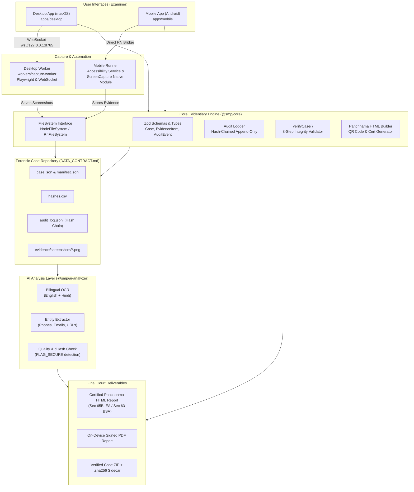

# SocialParse: Parsing of Social Media Feeds for Forensic Panchnamas

> **National Investigation Agency (NIA) — Anti-Cyber Terrorism Division (ACTD)**  
> **Domain / Category:** Cyber Forensics, Digital Evidence & Automated Feed Parsing (Desktop & Android)

---

## 1. Project Introduction

### 1.1 Overview & Purpose

**SocialParse** is an end-to-end digital forensics solution engineered for law enforcement agencies and cybercrime investigators. It automates the seizure, extraction, cryptographic verification, and legal documentation of social media feeds from suspect accounts across **Facebook, Instagram, X (formerly Twitter), Telegram, WhatsApp, and Google Services**.

The tool produces court-admissible electronic evidence bundles and **Panchnama** reports that strictly comply with **Section 65B of the Indian Evidence Act (IEA)** and **Section 63 of the Bharatiya Sakshya Adhiniyam 2023 (BSA)**.

### 1.2 Problem Statement

During counter-terrorism and cybercrime investigations, examining target social media accounts presents critical hurdles:

1. **Desktop Browser Authentication Barriers:** Accounts frequently trigger 2FA, OTP challenges, or device-fingerprint lockouts when opened on desktop browsers. Investigators must examine the feeds directly on an Android device (either suspect device or investigative clone).
2. **Chain of Custody & Legal Challenges:** Manual screenshotting is vulnerable to defense claims of tampering, omission, or date-time fabrication in court.
3. **Android `FLAG_SECURE` Obfuscation:** Privacy protections in messaging apps (e.g., Telegram Secret Chats) produce blank black frames when captured normally.
4. **Labor-Intensive Correlation:** Transcribing hundreds of phone numbers, handles, URLs, and bilingual messages by hand leads to investigative fatigue and errors.

### 1.3 What SocialParse Solves

- **Automated Capture Engine:** Automated feed scrolling and targeted screenshot acquisition on Android (via accessibility services) and Desktop (via Playwright browser automation).
- **Cryptographic Chain of Custody:** Calculates SHA-256 digests at the exact millisecond of capture; records all actions in an append-only, SHA-256 hash-chained audit diary (`audit_log.jsonl`).
- **Forensic Case Repository:** Standardized directory layout (`CASE-YYYY-NNNN/`) with machine-readable manifests (`manifest.json`) and flat CSV digests (`hashes.csv`).
- **Multimodal AI Analysis (`@smp/ai-analyzer`):** Offline bilingual OCR (English + Hindi), automated entity extraction (E.164 phone numbers, emails, `@mentions`, URLs, hashtags), duplicate perceptual hashing (`dHash`), and `FLAG_SECURE` black-frame detection.
- **Certified Panchnama Generation:** Generates tamper-proof HTML and PDF reports with witness signature blocks, cryptographic appendix, and embedded SVG verification QR codes.

### 1.4 Technologies & Tools

- **Core Engine:** TypeScript 5.8, Node.js 20+, Zod (data contract schemas).
- **Desktop Application:** React Native macOS 0.76, React 18, Metro bundler.
- **Mobile Application:** React Native 0.76 (Android), Android Accessibility Service, Android MediaProjection API, `react-native-fs`, `react-native-zip-archive`.
- **Capture Worker:** Node.js, Playwright, WebSocket server (`ws`).
- **AI & Forensics:** Tesseract.js (bilingual OCR), Sharp (image analysis & dHash), Vitest, Node.js Test Runner.
- **Quality & CI:** GitHub Actions CI, ESLint 9, Prettier.

---

## 2. System Architecture

SocialParse is structured as a monorepo using npm workspaces (`packages/*`, `apps/*`, `workers/*`):



### Component Roles

- **`packages/core` (`@smp/core`):** Platform-independent source of truth. Contains Zod validation schemas (`CaseSchema`, `EvidenceItemSchema`, `AuditEventSchema`), platform-agnostic `FileSystem` interface, SHA-256 dependency injection, audit log hash-chaining, `verifyCase` validator, and the Section 65B Panchnama HTML report generator.
- **`apps/desktop` (`@smp/desktop`):** Native macOS forensic management application. Manages FIR/case registration, platform feed selection, live WebSocket worker event streaming, and case verification.
- **`apps/mobile` (`mobile`):** Forensic Android application. Executes automated UI feed scrolling via Android Accessibility services, captures uncompressed frames, validates hashes, creates ZIP case archives with `.sha256` sidecars, and renders on-device PDF Panchnamas.
- **`workers/capture-worker`:** Dedicated Node.js capture engine utilizing Playwright for automated desktop browser harvesting. Communicates with desktop UI via the JSON-RPC WebSocket protocol defined in `docs/WORKER_PROTOCOL.md`.
- **`packages/ai-analyzer` (`@smp/ai-analyzer`):** Multimodal post-processing engine. Performs offline bilingual OCR, regex entity extraction, duplicate frame suppression, and black screen detection.

---

## 3. Case Repository Specification (`DATA_CONTRACT.md`)

Every forensic investigation creates an isolated folder named strictly after its unique Case ID (`CASE-YYYY-NNNN`):

```text
CASE-2026-0042/
├── case.json                  # Case metadata (FIR, examiner, agency, accused, device)
├── manifest.json              # Evidence items array with SHA-256 digests and UTC timestamps
├── hashes.csv                 # Flat CSV digest list for independent terminal verification
├── audit_log.jsonl            # Append-only SHA-256 hash-chained event ledger
├── analysis_summary.json      # Cross-platform entity index & investigative findings
├── instagram/
│   ├── analysis.json          # Platform-specific AI analysis results
│   └── screenshots/
│       ├── instagram_profile_0001_20261112T093158Z.png
│       └── instagram_feed_0002_20261112T093221Z.png
└── facebook/
    ├── analysis.json
    └── screenshots/
        └── facebook_profile_0003_20261112T093403Z.png
```

---

## 4. Prerequisites

| Software                 | Required Version                       | Purpose / Verification Command                              |
| ------------------------ | -------------------------------------- | ----------------------------------------------------------- |
| **macOS**                | 13.0+ (Ventura, Sonoma, Sequoia)       | Host development operating system (`sw_vers`)               |
| **Node.js**              | 20.x or 22.x LTS (Node 22 recommended) | Monorepo runtime (`node -v`)                                |
| **npm**                  | 10.x+                                  | Workspaces package manager (`npm -v`)                       |
| **Java / JDK**           | **JDK 17 strictly required**           | Required by React Native 0.76 & AGP 8.x (`java -version`)   |
| **Android Studio**       | Hedgehog / Koala / Ladybug             | Android SDK Platform 34, Build-Tools 34.0.0 (`adb version`) |
| **Android SDK Platform** | API 34 (Android 14)                    | Target runtime for mobile capture                           |
| **CocoaPods**            | 1.17.0+                                | macOS native pod manager for desktop app (`pod --version`)  |

> [!IMPORTANT]
> **Java 17 is strictly required.** Do not use JDK 21 or JDK 8. React Native 0.76 and Android Gradle Plugin 8.x will throw build errors under JDK 21+.

---

## 5. Complete Mac Setup Guide (Clean Clone)

Follow these exact steps to set up the repository on a fresh Mac.

### Step 1: Clone the Repository

```bash
git clone https://github.com/abhinavsingh-hub/SMP-MajorProject.git
cd SMP-MajorProject
```

### Step 2: Configure Environment Variables

Add the following to your `~/.zshrc` (or `~/.bash_profile`):

```bash
# 1. Java 17 Configuration
export JAVA_HOME=$(/usr/libexec/java_home -v 17 2>/dev/null || echo "/Library/Java/JavaVirtualMachines/jdk-17.jdk/Contents/Home")

# 2. Android SDK Configuration
export ANDROID_HOME=$HOME/Library/Android/sdk
export PATH=$PATH:$ANDROID_HOME/emulator
export PATH=$PATH:$ANDROID_HOME/platform-tools
export PATH=$PATH:$ANDROID_HOME/cmdline-tools/latest/bin

# 3. Homebrew & System Binaries
export PATH=$PATH:/opt/homebrew/bin:/usr/local/bin
```

Reload your shell:

```bash
source ~/.zshrc
```

Verify your environment:

```bash
node -v         # Should report v20.x, v22.x, or v25.x
npm -v          # Should report 10.x or 11.x
java -version   # Must output version 17.x
echo $ANDROID_HOME
```

### Step 3: Install Monorepo Dependencies

From the repository root:

```bash
npm install
```

### Step 4: Verify Monorepo Typechecking & Linting

Run the typechecker across packages:

```bash
npm run typecheck
```

Run ESLint:

```bash
npm run lint
```

### Step 5: Run the Complete Test Suite

Run all unit and end-to-end integration tests (140 tests):

```bash
npm test
```

### Step 6: Setting up Android AVD (For Mobile App)

> [!TIP]
> **For Apple Silicon Macs (M1/M2/M3/M4):** Always create an **`arm64-v8a`** emulator. Do not use `x86_64` images.

1. Install API 34 system image:
   ```bash
   sdkmanager "system-images;android-34;google_apis;arm64-v8a" "platforms;android-34" "build-tools;34.0.0"
   ```
2. Create an AVD:
   ```bash
   avdmanager create avd -n SocialParse_API_34 -k "system-images;android-34;google_apis;arm64-v8a" --device "pixel_7"
   ```
3. Start the emulator:
   ```bash
   $ANDROID_HOME/emulator/emulator -avd SocialParse_API_34 -netdelay none -netspeed full &
   ```
4. Verify via ADB:
   ```bash
   adb devices
   # Expected: emulator-5554 device
   ```

### Step 7: Launch the Mobile Application (Android)

In Terminal Tab 1 (start Metro bundler):

```bash
npm run start -w mobile
```

In Terminal Tab 2 (build and launch Android app):

```bash
npm run android -w mobile
```

### Step 8: Launch Desktop Application (macOS)

Install CocoaPods (if testing macOS native build):

```bash
cd apps/desktop/macos && pod install && cd ../../..
```

Start Metro bundler for desktop:

```bash
npm run start -w @smp/desktop
```

---

## 6. Monorepo Scripts Reference

All primary workflows are available directly from the repository root:

| Command                            | Workspace   | Description                                                                     |
| ---------------------------------- | ----------- | ------------------------------------------------------------------------------- |
| `npm test`                         | Monorepo    | Runs `@smp/core` unit & E2E tests, and `@smp/desktop` navigation & form tests.  |
| `npm run lint`                     | Monorepo    | Runs ESLint 9 across all packages and apps.                                     |
| `npm run typecheck`                | Monorepo    | Runs TypeScript compiler checks on `@smp/core` and `@smp/desktop`.              |
| `npm run format:check`             | Monorepo    | Verifies Prettier code formatting without writing files.                        |
| `npm run demo -w @smp/ai-analyzer` | AI Analyzer | Executes end-to-end demonstration generating a certified Panchnama HTML report. |
| `npm run start -w mobile`          | Mobile      | Starts the React Native Metro bundler for the Android app.                      |
| `npm run android -w mobile`        | Mobile      | Compiles and installs the Android APK onto the active emulator/device.          |
| `npm run start -w @smp/desktop`    | Desktop     | Starts the React Native Metro bundler for the desktop application.              |

---

## 7. Troubleshooting Common Errors

### 1. `java.lang.UnsupportedClassVersionError` or Gradle Build Failure

- **Cause:** Using JDK 21 or JDK 8 instead of JDK 17.
- **Fix:** Run `/usr/libexec/java_home -V` to list installed JDKs. Set `export JAVA_HOME=$(/usr/libexec/java_home -v 17)` in `~/.zshrc` and restart terminal.

### 2. Android Emulator Hangs or Rosetta Crash on Apple Silicon

- **Cause:** Using an `x86_64` system image on an ARM64 Apple Silicon Mac.
- **Fix:** In Android Studio AVD Manager, delete the x86 emulator and create a new emulator selecting **ARM64 v8a System Image** (API 34).

### 3. Port 8081 Already in Use

- **Cause:** A stale Metro bundler process is occupying port 8081.
- **Fix:** Run `lsof -ti :8081 | xargs kill -9` and restart the bundler.

### 4. `adb: device unauthorized` or `offline`

- **Cause:** USB debugging authorization prompt was not accepted on phone/emulator.
- **Fix:** Run `adb kill-server && adb start-server`, unlock phone screen, and tap "Always allow from this computer".

---

## 8. Documentation Sitemap

- **[USER_GUIDE.md](USER_GUIDE.md):** Examiner operations guide covering case creation, Panchnama workflow, report generation, and case export.
- **[PRESENTATION_OUTLINE.md](PRESENTATION_OUTLINE.md):** 10-slide academic and technical presentation outline.
- **[DEMO_SCRIPT.md](DEMO_SCRIPT.md):** 3-minute live demonstration script with timestamp cues.
- **[docs/DATA_CONTRACT.md](docs/DATA_CONTRACT.md):** Evidentiary standard, SHA-256 rules, and audit log hash chaining specifications.
- **[docs/WORKER_PROTOCOL.md](docs/WORKER_PROTOCOL.md):** WebSocket client-server messaging contract between Desktop UI and Playwright capture worker.
- **[docs/EXPORT_ANDROID.md](docs/EXPORT_ANDROID.md):** Technical instructions for pulling and verifying `.zip` archives and `.sha256` sidecars via ADB.
- **[docs/E2E_TESTING.md](docs/E2E_TESTING.md):** Technical documentation of the automated end-to-end testing suite and CI pipeline.
- **[docs/AI_ANALYZER.md](docs/AI_ANALYZER.md):** Technical breakdown of bilingual OCR, entity extraction, and dHash duplicate detection.
